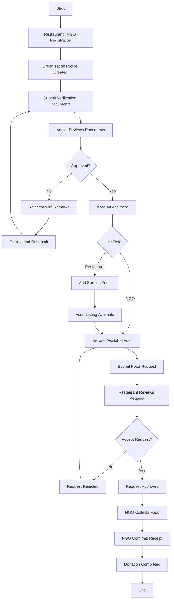

# FoodLoop – Project Workflow Documentation

## 1. Project Overview

**Project Name:** FoodLoop – Surplus Food Donation Platform

**Technology Stack:**
- Frontend: React.js + Vite
- Styling: Tailwind CSS
- Backend: Node.js + Express.js
- Database: MySQL
- API Communication: Axios
- Authentication: JWT
- Password Security: bcryptjs

### Project Objective

FoodLoop is a web-based platform that connects restaurants having surplus food with NGOs that can collect and distribute food to people in need.

The main objective is to reduce food wastage and make surplus food available to organizations working for social welfare.

---
---

## 3. Project Folder Structure

FoodLoop follows a separate frontend and backend architecture.

```text
FoodLoop/
│
├── frontend/
│   ├── public/
│   │
│   ├── src/
│   │   ├── assets/
│   │   │
│   │   ├── components/
│   │   │   ├── Navbar.jsx
│   │   │   ├── Footer.jsx
│   │   │   └── ProtectedRoute.jsx
│   │   │
│   │   ├── pages/
│   │   │   ├── Login.jsx
│   │   │   ├── Register.jsx
│   │   │   │
│   │   │   ├── admin/
│   │   │   │   └── AdminDashboard.jsx
│   │   │   │
│   │   │   ├── restaurant/
│   │   │   │   ├── RestaurantDashboard.jsx
│   │   │   │   ├── AddDonation.jsx
│   │   │   │   ├── MyDonations.jsx
│   │   │   │   └── IncomingRequests.jsx
│   │   │   │
│   │   │   └── ngo/
│   │   │       ├── NGODashboard.jsx
│   │   │       ├── AvailableFood.jsx
│   │   │       ├── FoodDetails.jsx
│   │   │       └── MyRequests.jsx
│   │   │
│   │   ├── services/
│   │   │   └── api.js
│   │   │
│   │   ├── context/
│   │   │   └── AuthContext.jsx
│   │   │
│   │   ├── App.jsx
│   │   ├── main.jsx
│   │   └── index.css
│   │
│   ├── index.html
│   ├── vite.config.js
│   └── package.json
│
├── backend/
│   ├── config/
│   │   └── db.js
│   │
│   ├── controllers/
│   │   ├── authController.js
│   │   ├── organizationController.js
│   │   ├── adminController.js
│   │   ├── donationController.js
│   │   └── requestController.js
│   │
│   ├── routes/
│   │   ├── authRoutes.js
│   │   ├── organizationRoutes.js
│   │   ├── adminRoutes.js
│   │   ├── donationRoutes.js
│   │   └── requestRoutes.js
│   │
│   ├── middleware/
│   │   ├── authMiddleware.js
│   │   └── roleMiddleware.js
│   │
│   ├── uploads/
│   │   └── .gitkeep
│   │
│   ├── .env
│   ├── .env.example
│   ├── server.js
│   └── package.json
│
├── database/
│   ├── schema.sql
│   └── sample_data.sql
│
├── docs/
│   └── project-workflow.md
│
├── .gitignore
└── README.md
```

### 3.1 Frontend Folder Responsibilities

| Folder/File | Responsibility |
|---|---|
| `assets/` | Images, logos and static assets |
| `components/` | Reusable UI components |
| `pages/` | Application pages |
| `pages/admin/` | Admin dashboard and verification pages |
| `pages/restaurant/` | Restaurant dashboard and donation pages |
| `pages/ngo/` | NGO dashboard and food request pages |
| `services/api.js` | Axios API configuration |
| `context/` | Authentication and logged-in user state |
| `App.jsx` | Application routes |
| `main.jsx` | React entry point |
| `index.css` | Tailwind CSS import and global styling |

### 3.2 Backend Folder Responsibilities

| Folder/File | Responsibility |
|---|---|
| `config/db.js` | MySQL connection pool |
| `controllers/` | Business logic and database operations |
| `routes/` | API endpoint definitions |
| `middleware/` | Authentication and role authorization |
| `uploads/` | Uploaded verification documents |
| `server.js` | Express server configuration |
| `.env` | Environment variables and secrets |
| `.env.example` | Environment variable template |

### 3.3 Database Folder Responsibilities

| File | Responsibility |
|---|---|
| `schema.sql` | Create all five database tables |
| `sample_data.sql` | Insert sample users, organizations and food records |

### 3.4 Common File Ownership

| File | Responsibility |
|---|---|
| `server.js` | Person 1 coordinates route registration |
| `db.js` | Shared MySQL connection |
| `App.jsx` | All members coordinate frontend routing |
| `api.js` | Shared Axios configuration |
| `schema.sql` | All members agree before modifying |
| `project-workflow.md` | Common project documentation |

---

## 4. Team-wise File Ownership

### Person 1 – Authentication and Admin

**Backend:**
- `controllers/authController.js`
- `controllers/organizationController.js`
- `controllers/adminController.js`
- `routes/authRoutes.js`
- `routes/organizationRoutes.js`
- `routes/adminRoutes.js`
- `middleware/authMiddleware.js`
- `middleware/roleMiddleware.js`

**Frontend:**
- `pages/Login.jsx`
- `pages/Register.jsx`
- `pages/admin/AdminDashboard.jsx`
- `context/AuthContext.jsx`
- `components/ProtectedRoute.jsx`

### Person 2 – Restaurant and Donations

**Backend:**
- `controllers/donationController.js`
- `routes/donationRoutes.js`

**Frontend:**
- `pages/restaurant/RestaurantDashboard.jsx`
- `pages/restaurant/AddDonation.jsx`
- `pages/restaurant/MyDonations.jsx`
- `pages/restaurant/IncomingRequests.jsx`

Also responsible for restaurant-side request acceptance and rejection.

### Person 3 – NGO and Requests

**Backend:**
- `controllers/requestController.js`
- `routes/requestRoutes.js`

**Frontend:**
- `pages/ngo/NGODashboard.jsx`
- `pages/ngo/AvailableFood.jsx`
- `pages/ngo/FoodDetails.jsx`
- `pages/ngo/MyRequests.jsx`

Also responsible for NGO-side request creation and completion confirmation.

**Important:** Person 2 and Person 3 share the `requests` table. Coordinate the request status names and API contracts before implementation.

---

## 5. Development Rules

1. Follow the agreed folder structure.
2. Use the same database and shared schema.
3. Use `api.js` for frontend API communication.
4. Keep database queries inside controllers or shared database services.
5. Keep authentication and role checks in middleware.
6. Never commit `.env` or uploaded private documents.
7. Use Git branches for individual development.
8. Test APIs in Postman before frontend integration.
9. Coordinate changes to shared files before merging.

---

## 2. User Roles

FoodLoop has three main user roles.

### A. Restaurant

Restaurants can:
- Register their organization.
- Submit verification documents.
- Check verification status.
- Add surplus food listings after approval.
- View their listed food.
- Edit or remove food listings.
- View incoming NGO requests.
- Accept or reject requests.
- View donation status.

### B. NGO

NGOs can:
- Register their organization.
- Submit verification documents.
- Check verification status.
- Browse available food listings after approval.
- View food details.
- Request available food.
- View their submitted requests.
- Track request status.
- Confirm food collection/receipt.

### C. Admin

Admin is responsible for platform verification and management.

Admin can:
- Login through an admin account.
- View registered restaurants and NGOs.
- View pending verification applications.
- Review submitted documents.
- Approve or reject organizations.
- Provide rejection remarks.
- View basic platform information.

**Note:** Admin accounts are created manually. Public registration cannot create an admin account.

---

## 3. Complete Application Workflow

### Step 1: User Registration

Both restaurants and NGOs can register on FoodLoop.

Registration information:
- Name
- Email
- Password
- Organization name
- Organization type
- Phone number
- Address
- City

After successful registration:
- A user record is created in the `users` table.
- An organization profile is created in the `organizations` table.
- Account status is set to `PENDING`.
- Organization verification status is set to `PENDING`.

### Step 2: Document Submission

Registered organizations submit their supporting verification documents.

For restaurants:
- Applicable FSSAI licence/registration details and document.

For NGOs:
- NGO Darpan ID/details and supporting documents, where applicable.

Uploaded document information is stored in the `verification_documents` table.

Initial document status: `PENDING`.

### Step 3: Admin Verification

Admin logs in and opens the pending verification section.

Admin reviews:
- Organization information.
- Submitted document.
- Document details.

Admin has two actions:

**Approve:**
- Document review status becomes `APPROVED`.
- Organization verification status becomes `APPROVED`.
- User account status becomes `ACTIVE`.

**Reject:**
- Document review status becomes `REJECTED`.
- Organization verification status becomes `REJECTED`.
- User account status becomes `REJECTED`.
- Admin provides rejection remarks.

Rejected organizations can correct their details and resubmit documents for review.

### Step 4: Restaurant Adds Surplus Food

Only approved and active restaurants can create food listings.

Food listing information:
- Food name
- Food category
- Quantity
- Unit
- Description
- Prepared date and time
- Available until

Food listing is stored in the `donations` table.

Initial donation status: `AVAILABLE`.

### Step 5: NGO Browses Available Food

Only approved and active NGOs can submit requests.

NGOs can:
- View available food listings.
- Search food by name.
- View restaurant and food details.
- Check available quantity.
- Check availability deadline.

Only active listings should be displayed as available.

### Step 6: NGO Requests Food

NGO selects a food listing and submits a request.

Request information:
- Donation ID
- NGO ID
- Requested quantity

A new record is created in the `requests` table.

Initial request status: `PENDING`.

The restaurant can now see the incoming request.

### Step 7: Restaurant Accepts or Rejects Request

Restaurant opens incoming requests and reviews the requested quantity.

**If accepted:**
- Request status becomes `APPROVED`.
- Donation status becomes `ACCEPTED`.
- Other conflicting pending requests are rejected or closed.
- The restaurant and NGO can view the updated status.

**If rejected:**
- Request status becomes `REJECTED`.
- Donation remains `AVAILABLE`, provided food is still available.
- Other NGOs can request the listing.

### Step 8: Donation Completion

After the NGO collects the food:
- NGO confirms collection/receipt.
- Request status becomes `COMPLETED`.
- Donation status becomes `COMPLETED`.

The donation workflow is now finished.

---

## 4. Workflow Diagram



---

## 5. Database Structure

FoodLoop uses five main database tables.

### 1. users

Stores login information and user roles.

Important fields:
- user_id (PK)
- name
- email
- password
- role
- account_status
- created_at

### 2. organizations

Stores restaurant and NGO information.

Important fields:
- organization_id (PK)
- user_id (FK)
- organization_name
- organization_type
- phone
- address
- city
- verification_status
- created_at

### 3. verification_documents

Stores organization verification document information.

Important fields:
- document_id (PK)
- organization_id (FK)
- document_type
- document_number
- document_url
- review_status
- reviewed_by (FK)
- reviewed_at
- remarks

### 4. donations

Stores surplus food listings.

Important fields:
- donation_id (PK)
- restaurant_id (FK)
- food_name
- category
- quantity
- unit
- description
- prepared_at
- available_until
- status
- created_at

### 5. requests

Stores NGO requests for food.

Important fields:
- request_id (PK)
- donation_id (FK)
- ngo_id (FK)
- quantity
- status
- requested_at

---

## 6. Database Relationships

- One user has one organization profile.
- One organization can submit multiple verification documents.
- One restaurant can create multiple donations.
- One donation can receive multiple requests.
- One NGO can create multiple requests.
- Admin users review organization documents.

All foreign keys must follow the agreed `schema.sql` structure.

---

## 7. API Development Plan

### Authentication APIs

| Method | Endpoint | Purpose |
|---|---|---|
| POST | /api/auth/register | Register restaurant or NGO |
| POST | /api/auth/login | User login |
| GET | /api/auth/profile | Get logged-in user |

### Organization APIs

| Method | Endpoint | Purpose |
|---|---|---|
| POST | /api/organizations/documents | Submit verification documents |
| GET | /api/organizations/verification-status | Check verification status |

### Admin APIs

| Method | Endpoint | Purpose |
|---|---|---|
| GET | /api/admin/verifications | View pending applications |
| GET | /api/admin/verifications/:id | View application details |
| PUT | /api/admin/verifications/:id | Approve or reject application |

### Donation APIs

| Method | Endpoint | Purpose |
|---|---|---|
| POST | /api/donations | Add food listing |
| GET | /api/donations | View available food |
| GET | /api/donations/my | View restaurant listings |
| GET | /api/donations/:id | View food details |
| PUT | /api/donations/:id | Update food listing |
| DELETE | /api/donations/:id | Remove food listing |

### Request APIs

| Method | Endpoint | Purpose |
|---|---|---|
| POST | /api/requests | Submit food request |
| GET | /api/requests/my | View NGO requests |
| GET | /api/requests/restaurant | View incoming requests |
| PUT | /api/requests/:id/status | Accept or reject request |
| PUT | /api/requests/:id/complete | Confirm completed donation |

---

## 8. Team Responsibilities

### Person 1 – Authentication and Admin Module

Responsible for:
- Registration and login.
- Password hashing.
- JWT authentication.
- Role-based authorization.
- Organization registration.
- Document submission.
- Admin verification.
- Verification status.

Main tables:
- users
- organizations
- verification_documents

### Person 2 – Restaurant and Donation Module

Responsible for:
- Restaurant dashboard.
- Add food listing.
- View own listings.
- Edit and remove listings.
- Incoming NGO requests.
- Accept or reject requests.
- Update donation status.

Main table:
- donations

Also owns the restaurant request-decision functionality in the shared requests table.

### Person 3 – NGO and Request Module

Responsible for:
- NGO dashboard.
- Browse available food.
- Food details.
- Submit food requests.
- View personal requests.
- View request status.
- Confirm food collection/receipt.

Main table:
- requests

---

## 9. Development Timeline

| Day | Main Work |
|---|---|
| Day 1 | Project setup, packages, folder structure, database and MySQL connection |
| Day 2 | Authentication, verification, donation and request APIs |
| Day 3 | Frontend dashboards and backend integration |
| Day 4 | Testing, bug fixing and final demonstration |

---

## 10. Important Business Rules

1. Only restaurants and NGOs can register publicly.
2. Admin accounts must be created manually.
3. Only approved and active restaurants can add food.
4. Only approved and active NGOs can request food.
5. Food quantity must be greater than zero.
6. Requested quantity cannot exceed available quantity.
7. Expired food cannot be requested.
8. Restaurants can only manage their own donations.
9. NGOs can only view and manage their own requests.
10. Only the restaurant that owns a donation can accept or reject its requests.
11. Only one request can be accepted for a donation in the simple MVP.
12. Donation and request statuses must remain consistent.
13. Rejected applications must retain their review history.
14. Passwords must always be stored as hashes.
15. All protected APIs must verify authentication, role and resource ownership.

---

## 11. Features Excluded from Current MVP

To complete the project within the available development time, the following features are not included:

- Payment gateway.
- Volunteer registration and management.
- Live GPS tracking.
- Automatic document verification.
- Email and SMS notifications.
- Advanced analytics.
- Delivery assignment system.

These can be considered future enhancements.

---

## 12. Expected Final Output

At the end of development, FoodLoop should support this complete workflow:

1. Restaurant registers.
2. NGO registers.
3. Both submit verification documents.
4. Admin approves or rejects applications.
5. Approved restaurant adds surplus food.
6. Approved NGO browses available food.
7. NGO requests food.
8. Restaurant accepts or rejects the request.
9. NGO confirms collection.
10. Donation is marked completed.

**Final Goal:** A functional surplus food donation platform demonstrating registration, organization verification, food listing, NGO requests and donation completion.

---

**Project:** FoodLoop  
**Type:** CDAC Web Programming Technologies Mini Project  
**Frontend:** React + Tailwind CSS  
**Backend:** Node.js + Express.js  
**Database:** MySQL
